# SmartCourse: Architecture Design (HLD + LLD)

| | |
| --- | --- |
| **System** | SmartCourse Core, the backend for EduCorp's learning platform (Part A, no GenAI) |
| **Covers** | High-level design, API gateway, authentication and authorization, inter-service communication, low-level design, NFRs, risks |
| **Code basis** | `smartcourse-core` monorepo as of 2026-11-10 |
| **Sources** | `.claude/Requirement.md` (brief), `.claude/Claude.md` (architecture rules), `.claude/Api_design.md` (API surface), `docs/adr/0001–0010`, source code |

### How to read this document

Every component is tagged with its status. **Keep the two separate when you present.** A
reviewer who finds that a "designed" item isn't built will stop trusting the "built" items.

| Tag | Meaning |
| --- | --- |
| ✅ **Built** | In the code today, covered by tests (114 test functions across gateway, identity, course and platform-core) |
| 🟡 **Designed** | Specified in `Claude.md` / `Api_design.md` / ADRs, not implemented yet |

---

# Part 1: High-Level Design

## 1. Problem → architecture drivers

Every major decision traces back to a problem in the brief. This table is the spine of the
defence.

| Problem stated in the brief | Architectural answer | Status |
| --- | --- | --- |
| Data is scattered and inconsistent across course, enrollment and analytics | One database per service, a **transactional outbox** so state changes and events commit atomically, **inbox dedupe** on consumers, invariants enforced as DB constraints | ✅ DB-per-service · 🟡 outbox/inbox |
| Content publishing is slow and manual; partial failures corrupt it | Publishing is a **Temporal saga** owned by `course` with compensation (remove partial chunks, roll status back, keep the previous version live) | 🟡 |
| High traffic delays enrollments and notifications | Enrollment is **one local transaction** with no network calls, using a local read model (`course_cache`). Side effects are **asynchronous via Kafka** | 🟡 |
| Background work is unreliable and hard to diagnose | Temporal (durable orchestration), Kafka (replayable log), Celery (retryable tasks), DLQ endpoints, `/admin/workflows` | 🟡 |
| Weak observability | `X-Request-ID` propagated edge → service and on every log line (structlog JSON). OTel → Jaeger and Prometheus are designed | ✅ request-id/logging · 🟡 tracing/metrics |
| Dashboards disagree with reality | Analytics are **projections** built from a retained Kafka log, rebuildable by replay, with `meta.as_of` returned so staleness is visible | 🟡 |
| Spikes during course launches | Services scale independently. The gateway is stateless. Redis is used for throttles and caches | ✅ partially |

## 2. System context

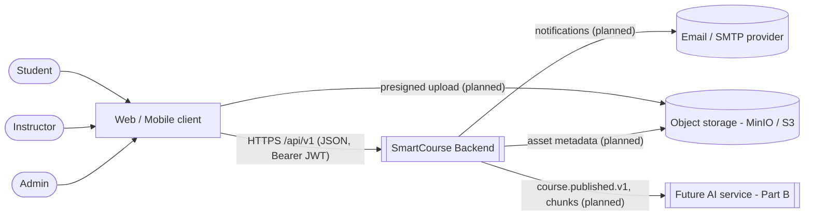

## 3. Target architecture: containers

Six business services behind one gateway, sharing **one** Postgres engine (a separate database
per service), **one** Redis, **one** Kafka cluster, **one** Temporal cluster.

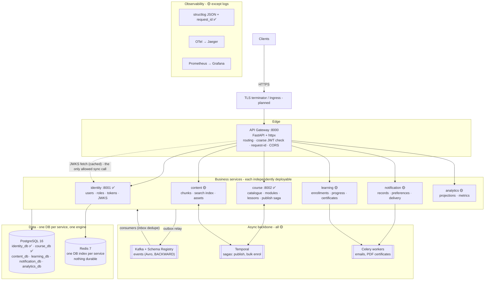

## 4. What is running today

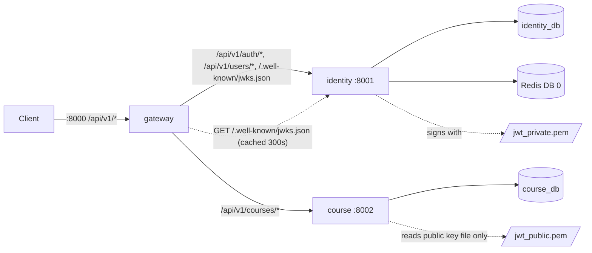

| Deployable | Port | Store | Responsibility |
| --- | --- | --- | --- |
| `gateway` | 8000 | none | Path routing, coarse token check, request-id propagation, CORS, aggregated `/health` |
| `services/identity` | 8001 | `identity_db`, Redis DB 0 | Register, login, refresh (rotating + reuse detection), logout, `/auth/me`, password reset, JWKS |
| `services/course` | 8002 | `course_db` | Course CRUD: create (instructor), browse/search (public), read, update/archive (owner or admin) |
| `libs/platform-core` | — | — | Shared **mechanics only**: envelope, errors, logging, middleware, routing discovery, JWT verification, DB sessions, health |

## 5. Service catalogue (target)

| Service | Owns (system of record) | Scales on | Why it is a separate service |
| --- | --- | --- | --- |
| **identity** | users, roles, refresh tokens, JWKS | login bursts | Only token issuer. Holds the private key; blast radius is isolated |
| **course** | courses, modules, lessons (metadata **and** body), prerequisites, versions, publish runs | catalogue reads | Aggregate owner **and** publish orchestrator in one place |
| **content** | derived artifacts only: chunks, search index, processed assets | processing spikes | CPU-heavy extraction is isolated from catalogue reads. Everything here is rebuildable from `course` |
| **learning** | enrollments, progress, completions, certificates, `course_cache` | enrollment spikes (the hot path) | Highest write volume. Must keep working when other services are down |
| **notification** | notification records, preferences | fan-out bursts | A mail outage must never fail a business operation |
| **analytics** | projections, all reported metrics | dashboard reads | Read-optimised, eventually consistent, rebuildable by replay |

**Boundaries deliberately *not* drawn** (be ready to defend these):

- `users` stays inside `identity`: a profile and its credential share one lifecycle and one primary key.
- `progress` stays inside `learning`: enrolling initialises progress, so the two tables are always written together. Splitting them turns one transaction into a saga.
- Lesson **bodies** stay in `course`, not `content`: they are created in the same request as the lesson metadata. Splitting them would be a dual write with no transaction across it.

## 6. Architectural principles (the four non-negotiable rules)

1. **No service reads another service's database.** Cross-service references are by UUID only. For example, `courses.instructor_id` has **no** foreign key ([ADR 0010](../adr/0010-split-into-services.md)).
2. **No synchronous service-to-service call on a request path.** The single exception is the gateway fetching JWKS from identity, and that response is cached.
3. **No shared business logic.** `platform-core` holds mechanics only. A domain rule there would force every service to redeploy.
4. **Every cross-service fact is a versioned event** (Avro, Schema Registry, `BACKWARD` compatibility enforced in CI).

## 7. Technology stack

| Concern | Choice | Status | Note vs. the brief |
| --- | --- | --- | --- |
| Language / framework | Python 3.12, FastAPI, Pydantic v2 | ✅ | As specified |
| Server | uvicorn (exec'd via `python -m src.main`, [ADR 0007](../adr/0007-dev-server-execs-into-uvicorn-cli.md)) | ✅ | |
| Relational DB | PostgreSQL 16, SQLAlchemy 2.0 async + asyncpg, Alembic per service | ✅ | As specified |
| NoSQL DB | **Removed.** Postgres `jsonb` + GIN is used instead | ✅ decision | **Deviation.** Defended in §16, Q1 |
| Cache / throttles | Redis 7 (`redis.asyncio`), one DB index per service | ✅ (identity) | As specified |
| Events | Kafka + Schema Registry (Avro) | 🟡 | As specified |
| Workflows | Temporal | 🟡 | As specified |
| Tasks | Celery (broker: RabbitMQ per the brief; confirm) | 🟡 | As specified |
| Object storage | MinIO (S3-compatible) | 🟡 | **Addition.** The brief needs uploads but names no blob store |
| Auth crypto | PyJWT (RS256), `cryptography`, `argon2-cffi` (Argon2id) | ✅ | |
| Logging | structlog (JSON) | ✅ | |
| Tracing / metrics | OpenTelemetry → Jaeger; `prometheus-client` → Grafana | 🟡 | As specified |
| Tooling | uv workspace, ruff, mypy `--strict`, pytest + testcontainers | ✅ | |
| Packaging | Docker (one image per service), Docker Compose | ✅ | As specified |

## 8. Deployment view

**Local / Docker Compose (✅):** [`deploy/docker-compose.yml`](../../deploy/docker-compose.yml)
runs `postgres:16` (with `identity_db` and `course_db` created by `init.sql`), `redis:7`,
`identity`, `course` and `gateway`. Migrations run on container start; that is a dev convenience
only. JWT keys are mounted read-only from `secrets/`. Course receives **only** the public key.

**Production (🟡 recommended target):**

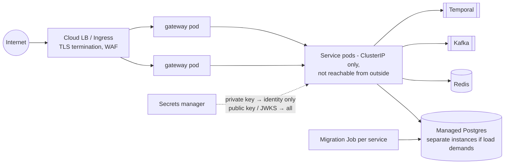

- Liveness probe → `/version` (no dependency access). Readiness probe → `/health` (checks dependencies). A Redis blip must not restart healthy pods (`Claude.md` §11).
- Migrations run as a separate job, never from the app container.
- Service ports must **not** be published outside the cluster (see Risk R2).

---

# Part 2: API Gateway

## 9. Which gateway we use, and why

**A custom, stateless FastAPI reverse proxy** in [`gateway/`](../../gateway/src/app.py), built on
`httpx.AsyncClient`. It is not Kong, Nginx, Traefik or AWS API Gateway.

**Why build it ourselves ([ADR 0010](../adr/0010-split-into-services.md)):**

| Reason | Detail |
| --- | --- |
| One error contract end to end | It reuses `platform-core`'s exception handlers, so an edge error (`401`, `404`, `502`, `504`) has exactly the same `{code, message, details, request_id}` shape as a service error |
| Same request-id and logging stack | Uses the same `RequestContextMiddleware` and structlog config, so the gateway's and the service's access lines share one `request_id` |
| Token check needs JWKS caching with a refresh-throttle and a deliberate *signature-only* policy | This takes about 90 lines of Python. In Nginx it would need Lua/njs or a plugin |
| Small and stateless | Roughly 300 lines, no database, horizontally scalable |
| Same toolchain | Same tests (pytest), types (mypy strict) and image pattern as every service |

**Trade-off you should state openly:** a hand-rolled gateway does not give you TLS termination,
a WAF, connection-level DDoS protection, or high-performance streaming. In production it sits
**behind** a TLS-terminating load balancer or ingress. If gateway features grow (rate limiting
at scale, canary routing, API keys), replacing it with Kong/Envoy/Traefik is a contained change,
because clients only see the `/api/v1` paths.

## 10. Gateway responsibilities

| Responsibility | Implementation | Status |
| --- | --- | --- |
| Single entry point `/api/v1` | Catch-all route `/{path:path}` in [`app.py:94`](../../gateway/src/app.py#L94) | ✅ |
| Path-prefix routing | [`route_table`](../../gateway/src/proxy.py#L37): whole-segment match, so `/courses` never captures `/courses-archive` | ✅ |
| Coarse JWT check (signature only) | [`JWKSVerifier.reject_forged`](../../gateway/src/auth.py#L63) | ✅ |
| Request-ID propagation | Mints or accepts `X-Request-ID` and forwards it upstream | ✅ |
| Client IP propagation | Appends `X-Forwarded-For`, sets `X-Forwarded-Proto` / `X-Forwarded-Host` | ✅ |
| Hop-by-hop header stripping | RFC 9110 §7.6.1 set; also drops `content-encoding` (httpx already decoded the body) | ✅ |
| Upstream failure mapping | `httpx.TimeoutException` → `504 UPSTREAM_TIMEOUT`; transport error → `502 UPSTREAM_UNAVAILABLE` | ✅ |
| CORS | Explicit origins from settings | ✅ |
| Aggregated health | `/health` is `200` only if every upstream `/health` is `200` | ✅ |
| Rate limiting | Redis sliding window (limits in `Api_design.md` §13) | 🟡 |
| OpenAPI aggregation | Each service serves its own `/docs` today | 🟡 |
| TLS | Delegated to the LB / ingress | 🟡 |

**Route table (today):**

| Path prefix | Upstream |
| --- | --- |
| `/api/v1/auth/*` | identity |
| `/api/v1/users/*` | identity (no routes yet) |
| `/.well-known/jwks.json` | identity |
| `/api/v1/courses/*` | course |

Adding a service means one line in `route_table` plus one upstream URL setting. This is the
**only** central registry in the platform, by design.

## 11. Gateway request lifecycle

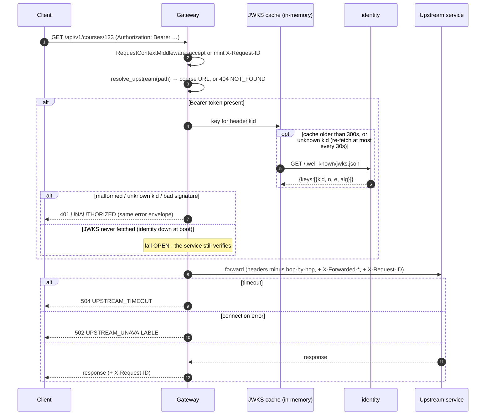

**Why the gateway does *not* check expiry, role or revocation:** clients routinely send their
expired access token along with `POST /auth/refresh`, so rejecting expired tokens at the edge
would break refresh. Expiry, roles, ownership and revocation are decided by the owning service.
The gateway only stops garbage (forged or malformed tokens) early.

---

# Part 3: Authentication and Authorization

## 12. Model

| Aspect | Decision |
| --- | --- |
| Issuer | `identity` only. It is the sole holder of the RSA private key |
| Token format | JWT, **RS256** (asymmetric), `kid` in the header, public keys published at `/.well-known/jwks.json` |
| Verification | **Offline** in every service, using the public key. No introspection call, no shared secret. Users can keep using the platform if identity is down |
| Access token | 15 min. Claims: `sub` (user id), `role`, `type="access"`, `jti`, `iat`, `exp`. Required claims enforced: `exp, iat, sub, jti, type` |
| Refresh token | 30 days. Opaque, 48 random bytes (`secrets.token_urlsafe`). Stored as a **SHA-256 hash** with a `family_id`. **Rotates on every use** |
| Reuse detection | Presenting a rotated-out refresh token revokes the **whole family** and logs `refresh_token_reuse_detected` |
| Passwords | **Argon2id** (`argon2-cffi`) |
| Logout | Revokes the refresh family **and** puts the access token's `jti` on a Redis denylist (TTL = remaining token life) |
| Authorization | RBAC with three flat roles (`student`, `instructor`, `admin`) via the `require_roles(...)` dependency. **Ownership** checks live in the owning service |
| Admin provisioning | Never self-assignable. Only via `make create-admin` (CLI) |
| Auth placement | A FastAPI **dependency**, not middleware, so OpenAPI shows which routes need auth and public routes are explicit |

**Why RS256 + JWKS instead of HS256 or sessions:**
- HS256 would require every service to hold the signing secret, so any compromised service could mint admin tokens. With RS256, services hold only the public key and **cannot** issue tokens.
- Server sessions or token introspection would put identity on every request path. That violates rule 2 and makes identity a single point of failure.
- `kid` + JWKS allow key rotation without downtime (see Risk R6 for what is still missing).

## 13. Defence in depth (three verification layers)

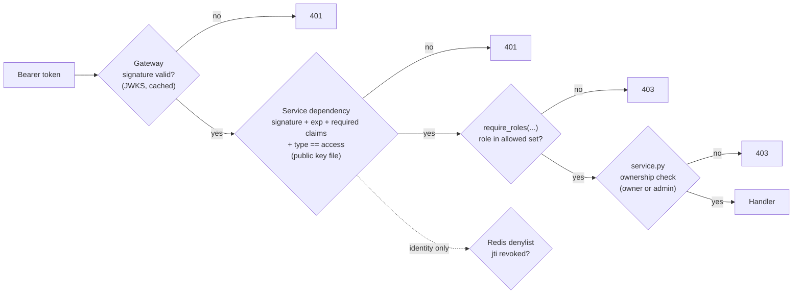

Services **never trust the gateway alone**. Anything reaching a pod directly is still fully
authenticated.

## 14. Authentication flows

### 14.1 Register

```mermaid
sequenceDiagram
    participant C as Client
    participant I as identity
    participant R as Redis DB0
    participant DB as identity_db
    C->>I: POST /auth/register {email, password, full_name, role∈{student,instructor}}
    I->>R: INCR auth:register_throttle:{ip} (EXPIRE 3600 on first)
    alt > 10/hour
        I-->>C: 429 RATE_LIMITED
    end
    I->>DB: SELECT user by email
    alt exists
        I-->>C: 409 CONFLICT
    end
    I->>I: Argon2id hash
    I->>DB: INSERT users (one transaction, commit on success)
    I->>I: LoggingNotificationSender (stub; becomes user.registered.v1 via outbox 🟡)
    I-->>C: 201 {data: UserPublic, meta}
```

### 14.2 Login

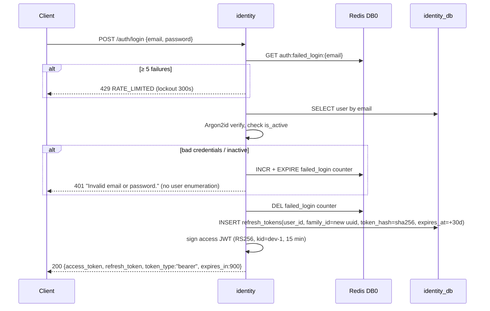

### 14.3 Refresh with rotation and reuse detection

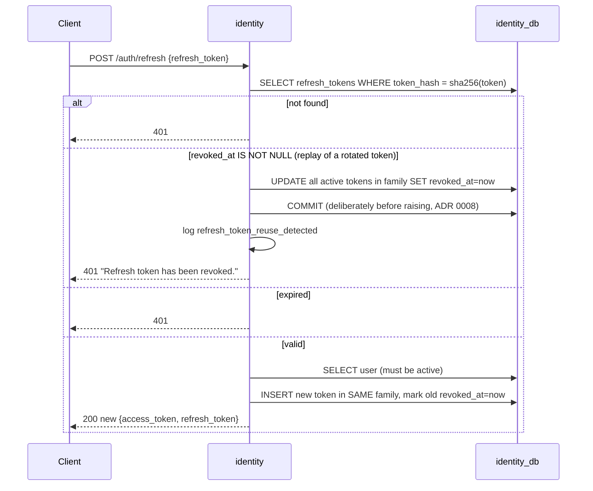

The explicit `COMMIT` before raising is a deliberate exception to "services don't commit".
Without it, the error response would roll back the family revocation, which is the whole point
of that code path ([`service.py:182`](../../services/identity/src/modules/auth/service.py#L182)).

### 14.4 Authenticated request in a non-identity service (course)

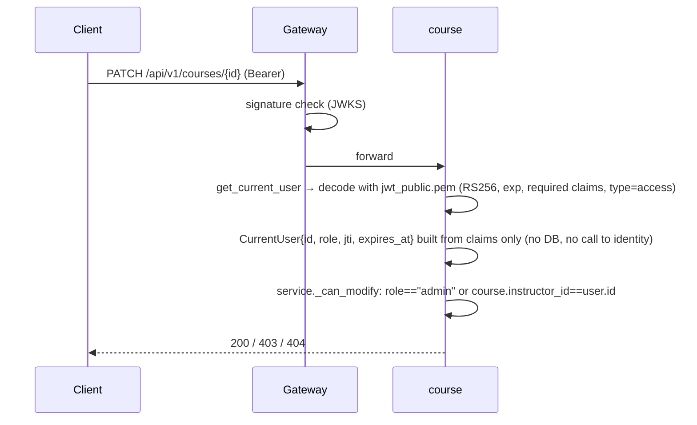

### 14.5 Logout and password reset

- **Logout** (`POST /auth/logout`, authenticated): revokes the refresh family in Postgres and sets `auth:denylist:{jti}` in Redis with TTL equal to the token's remaining life. Identity rejects that access token **immediately**. Other services reject it **at expiry (≤ 15 min)**, because the denylist is identity's data ([ADR 0010](../adr/0010-split-into-services.md)). The planned fix, if the product needs it, is a `session.revoked` event feeding each service's local denylist. A shared store is not an option.
- **Forgot password**: always returns `202`, so it never reveals whether an email exists. Stores `auth:password_reset:{sha256(token)} → user_id` (TTL 30 min).
- **Reset password**: `GETDEL` makes the token single-use. Sets a new Argon2id hash and revokes **all** of the user's refresh tokens.

### 14.6 Authorization matrix (implemented endpoints)

| Endpoint | Public | Student | Instructor | Admin | Extra rule |
| --- | :-: | :-: | :-: | :-: | --- |
| `POST /auth/register` | ✔ | | | | role ∈ {student, instructor} only |
| `POST /auth/login`, `/refresh`, `/password/*` | ✔ | | | | throttles / lockout |
| `POST /auth/logout`, `GET /auth/me` | | ✔ | ✔ | ✔ | denylist check |
| `POST /courses` | | | ✔ | | `require_roles("instructor")` |
| `GET /courses`, `GET /courses/{id}` | ✔ | ✔ | ✔ | ✔ | see Risk R1 |
| `PATCH /courses/{id}`, `DELETE /courses/{id}` | | | owner | ✔ | `_can_modify` in `service.py` |

---

# Part 4: Inter-Service Communication

## 15. Strategy

**Today (✅):** the business services never call each other. The only network hops are:

| From → To | Protocol | Purpose | Sync? |
| --- | --- | --- | --- |
| Client → gateway | HTTP/JSON | All API traffic | sync |
| Gateway → identity / course | HTTP (httpx proxy) | Request forwarding | sync (edge only, not service-to-service) |
| Gateway → identity | HTTP `GET /.well-known/jwks.json` | Public keys, cached 300 s | sync, the **one allowed** exception |
| Gateway → each service | HTTP `GET /health` | Aggregated health | sync, ops only |
| course → identity | **none**. Verifies JWT with the public key file | | |

**Target (🟡):** three asynchronous mechanisms, each used for one kind of job only.

| Need | Tool | Why not the others |
| --- | --- | --- |
| Multi-step process that must **compensate** and **survive a restart** (publishing, bulk enrolment) | **Temporal** | A queue can retry a step but cannot undo steps 1–3 when step 4 fails |
| Broadcast one fact to many independent consumers; **replay** history to rebuild projections | **Kafka** | A queue deletes a message once consumed: one consumer, no replay |
| One retryable unit of work (send an email, render a PDF) | **Celery** | Temporal is too heavy for a single-step job |

> **Temporal orchestrates. Kafka informs. Celery executes.**

If scope has to be cut, the ranking is: keep Temporal (compensation is hardest to hand-roll),
then Kafka (replay). Celery could be replaced by a `jobs` table with `SKIP LOCKED`.

### 15.1 Reliable event publishing: transactional outbox + inbox

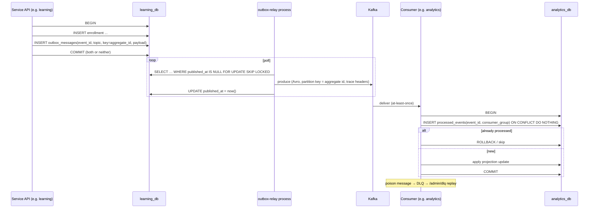

- **The API process never talks to Kafka.** Only the relay produces. The confluent-kafka client is blocking, so it is kept off the event loop ([ADR 0001](../adr/0001-architecture-decisions.md) §6).
- **Three idempotency layers, kept separate:** consumer inbox (broker redelivery), `Idempotency-Key` header + body hash in Redis for 24 h (client retry), natural-key DB constraints (programming error).

### 15.2 Publishing saga (Temporal, owned by `course`)

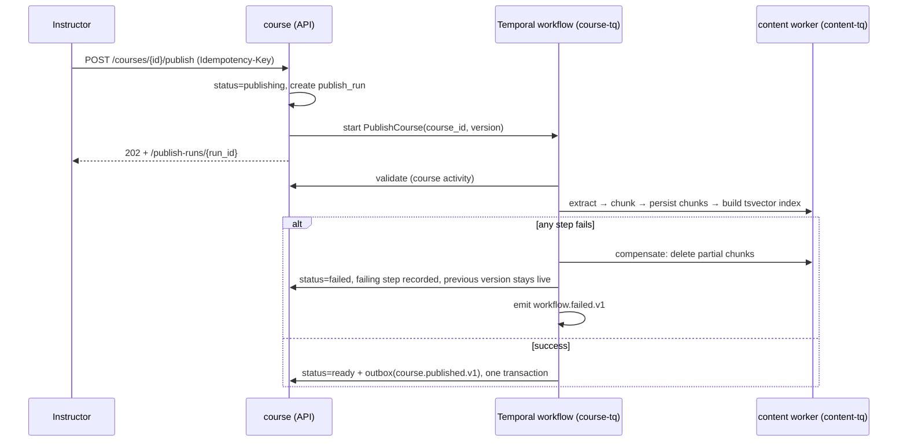

The two services never hold an HTTP client for each other. Each runs a Temporal worker on its own
task queue (`course-tq`, `content-tq`), and the workflow schedules activities onto the other
service's queue.

### 15.3 Enrollment (the hot path, no network calls)

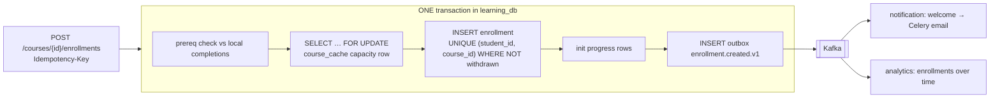

`course_cache` is a **local read model** fed by `course.*` events, so enrollment never calls
`course`. Trade-off: capacity can be a few seconds stale, so a burst may overshoot by a small
margin. Either a waitlist or a reconciliation job addresses this; it is an open question for the
client.

### 15.4 Event catalogue (🟡)

Topic name format: `smartcourse.<domain>.<event>.v<major>`. Partition key is the aggregate id. Schemas are Avro with `BACKWARD` compatibility.

| Event | Producer | Consumers |
| --- | --- | --- |
| `user.registered.v1` | identity | notification, analytics, learning (name snapshot) |
| `user.role_changed.v1`, `instructor.approved.v1` | identity | analytics, notification |
| `course.created/updated/published/unpublished/archived.v1` | course | learning (`course_cache`), analytics, notification, *(ai)* |
| `content.indexed.v1` | content | course (workflow), *(ai)* |
| `asset.registered.v1` | content | analytics |
| `enrollment.created.v1` / `enrollment.withdrawn.v1` | learning | notification, analytics |
| `progress.updated.v1`, `course.completed.v1` | learning | analytics, notification (certificate) |
| `workflow.failed.v1` | any | analytics, alerting |

### 15.5 Service-to-service authentication (🟡)

When internal calls appear (Temporal activities, admin fan-out), tokens carry
`aud: <target-service>` and a service subject type, still RS256 and still verified offline.
mTLS via a service mesh is an infra-level option on top of that.

---

# Part 5: Low-Level Design

## 16. Repository layout

```
smartcourse-core/
├── gateway/src/            app.py · auth.py (JWKSVerifier) · proxy.py (route_table, forward) · config.py · main.py
├── services/
│   ├── identity/src/       app.py · config.py · main.py
│   │   ├── core/           router.py · dependencies.py (get_current_user + denylist) · security.py (Argon2, JWT sign, JWKS)
│   │   ├── db/             base.py · postgres.py · redis.py
│   │   └── modules/        auth/{routes,service,models,schemas}.py · users/{service,models}.py
│   └── course/src/         app.py · config.py · main.py
│       ├── core/           router.py · dependencies.py
│       ├── db/             base.py · postgres.py
│       └── modules/        courses/{routes,service,models,schemas}.py
├── libs/platform-core/     platform_core: config · logging · middleware · exceptions · handlers · response · routing · security · db · health
├── deploy/                 docker-compose.yml · postgres/init.sql
├── scripts/                create_databases.py · cutover_from_monolith.py
└── docs/                   adr/0001–0010 · architecture/
```

One `uv` workspace and one lockfile. Each deployable has its own `pyproject.toml`, Dockerfile,
`.env`, and Alembic chain. Services import their own code as `src` and are not installed as
packages; only `platform-core` is installed.

## 17. Service internals (identical in every service)

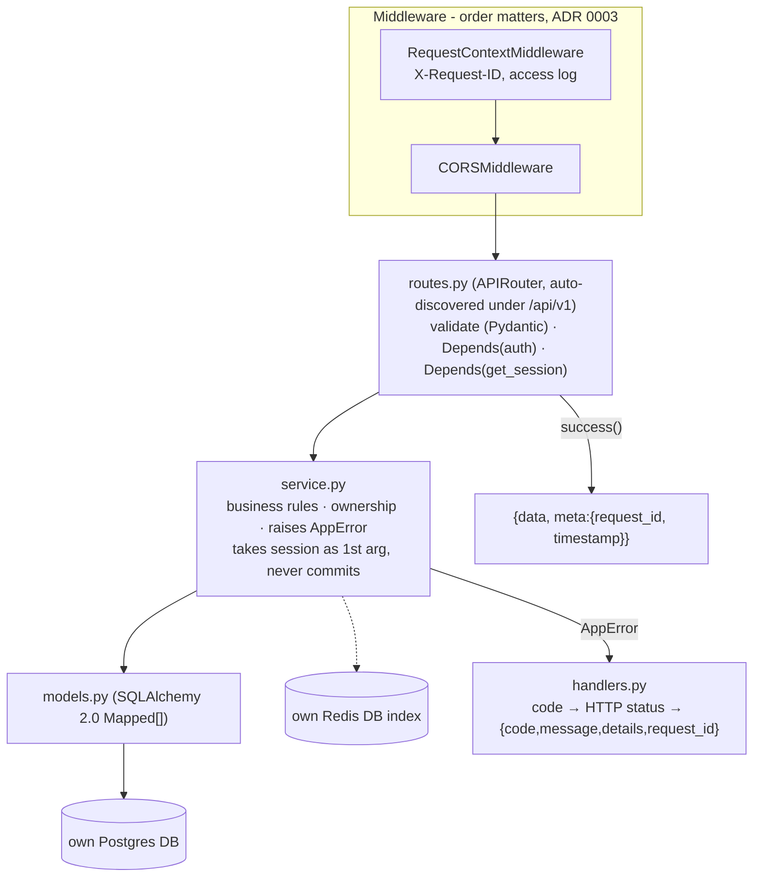

| Layer | Rule |
| --- | --- |
| `routes.py` | HTTP only. Exposes exactly one `router`, picked up automatically by [`platform_core.routing`](../../libs/platform-core/src/platform_core/routing.py). No central route list |
| `service.py` | All business logic. **Never imports FastAPI.** Receives the session as its first argument, so the same function works from a route, consumer, Temporal activity or Celery task |
| Transactions | One per request. [`get_session`](../../libs/platform-core/src/platform_core/db.py#L85) commits on clean exit and rolls back on exception. Services `flush()` and never `commit()` (one documented exception, §14.3) |
| Errors | `AppError` subclasses → [`handlers.py`](../../libs/platform-core/src/platform_core/handlers.py), the **only** place that maps errors to HTTP status codes |
| Layering | `routes → service → models`. `core/` and `db/` never import `modules/`. Modules don't import each other (single documented exception: `auth → users`, [ADR 0008](../adr/0008-auth-module-and-enum-storage-gotcha.md)) |

## 18. `platform-core` (shared mechanics, no domain logic)

| Module | Responsibility | Key types / functions |
| --- | --- | --- |
| `config.py` | Composable settings groups | `AppSettings`, `PostgresSettings`, `RedisSettings`, `JWTVerifySettings`, `CorsSettings`, `HealthSettings` |
| `logging.py` | structlog → stdlib, `request_id` contextvar, `service.name` on every line | `configure_logging`, `bind_request_id`, `current_request_id` |
| `middleware.py` | Pure-ASGI request context (not `BaseHTTPMiddleware`) plus CORS in fixed order | `RequestContextMiddleware`, `install_middleware` |
| `exceptions.py` | Error hierarchy | `NotFoundError`, `ConflictError`, `ValidationError`, `UnauthorizedError`, `ForbiddenError`, `BusinessRuleError`, `RateLimitedError`, `UpstreamUnavailableError`, `UpstreamTimeoutError` |
| `handlers.py` | Error code → HTTP status, one error shape | `register_exception_handlers` |
| `response.py` | Success envelope + opaque cursor | `Envelope[T]`, `success()`, `CursorPage[T]`, `encode_cursor`/`decode_cursor` |
| `routing.py` | Auto-discovers `src/modules/*/routes.py` | `build_api_router` |
| `security.py` | Offline JWT verification + RBAC dependency | `decode_access_token`, `authenticate`, `CurrentUser`, `roles_dependency` |
| `db.py` | Engine/session lifecycle, Redis client, mixins, naming convention | `PostgresDatabase`, `RedisConnection`, `UUIDMixin`, `TimestampMixin` (tz-aware) |
| `health.py` | `/health` (concurrent checks, 2 s timeout each, 5 s cache) and `/version` | `HealthChecker`, `build_health_router` |

**API contracts (all services):**

```jsonc
// success
{ "data": { ... }, "meta": { "request_id": "…", "timestamp": "2026-11-10T…Z" } }
// list
{ "data": { "items": [ ... ], "next_cursor": "eyJjcmVhdGVkX2F0Ij…", "has_more": true }, "meta": { ... } }
// error (from handlers.py only)
{ "code": "FORBIDDEN", "message": "…", "details": [{ "field": "…", "message": "…" }], "request_id": "…" }
```

| Error code | HTTP |
| --- | --- |
| `NOT_FOUND` | 404 |
| `CONFLICT` | 409 |
| `VALIDATION_ERROR`, `BUSINESS_RULE_VIOLATION` | 422 |
| `UNAUTHORIZED` | 401 |
| `FORBIDDEN` | 403 |
| `RATE_LIMITED` | 429 |
| `UPSTREAM_UNAVAILABLE` | 502 |
| `UPSTREAM_TIMEOUT` | 504 |
| anything unhandled | 500 `INTERNAL_ERROR` |

## 19. Identity service: LLD

### 19.1 Data model (`identity_db`)

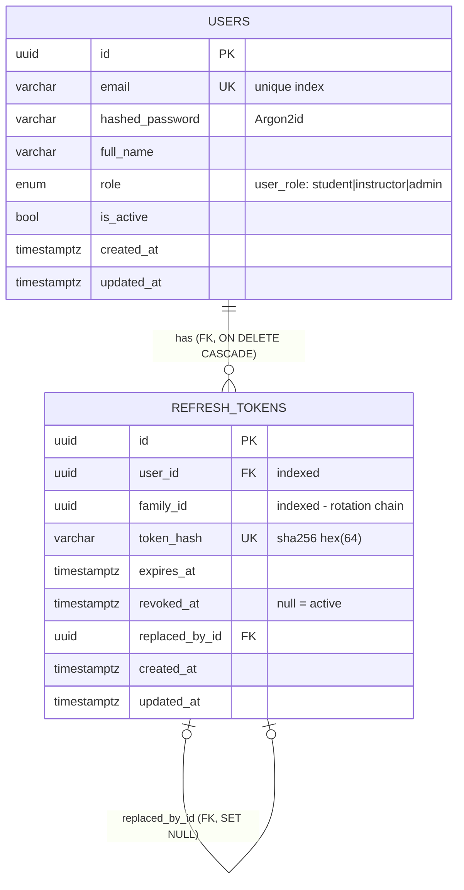

Design notes that come up in review:
- Enums use `values_callable` so Postgres stores `student`, not `STUDENT` ([ADR 0008](../adr/0008-auth-module-and-enum-storage-gotcha.md)).
- Every timestamp is `timestamptz` (asyncpg rejects tz-aware values in naive columns).
- Refresh tokens are hashed with SHA-256, not Argon2: they already carry 384 bits of entropy, so a slow hash adds cost without adding security.

### 19.2 Redis keyspace (DB 0, nothing durable)

| Key | Value | TTL | Purpose |
| --- | --- | --- | --- |
| `auth:register_throttle:{ip}` | counter | 3600 s | Max 10 registrations per hour per IP |
| `auth:failed_login:{email}` | counter | 300 s | Lockout after 5 failures |
| `auth:password_reset:{sha256(token)}` | user_id | 30 min | Single-use (`GETDEL`) |
| `auth:denylist:{jti}` | `"1"` | remaining token life | Immediate logout inside identity |

### 19.3 Endpoints (✅)

| Method & path | Request | Response | Notes |
| --- | --- | --- | --- |
| `POST /api/v1/auth/register` | `{email, password(8–128), full_name, role?}` | `201 UserPublic` | 409 duplicate, 429 throttle |
| `POST /api/v1/auth/login` | `{email, password}` | `200 TokenPair` | 401 generic, 429 lockout |
| `POST /api/v1/auth/refresh` | `{refresh_token}` | `200 TokenPair` | Rotation, reuse detection |
| `POST /api/v1/auth/logout` | `{refresh_token}` + Bearer | `204` | Family revoke + jti denylist |
| `GET /api/v1/auth/me` | Bearer | `200 UserPublic` | Live DB row |
| `POST /api/v1/auth/password/forgot` | `{email}` | `202` | No enumeration |
| `POST /api/v1/auth/password/reset` | `{token, new_password}` | `204` | Revokes all sessions |
| `GET /.well-known/jwks.json` | — | `{keys:[{kty,use,alg,kid,n,e}]}` | RFC 5785 location |
| `GET /health`, `GET /version` | — | — | Infra endpoints, outside `/api/v1` |

### 19.4 Key configuration

`SMARTCOURSE_SECURITY__*`: `JWT_PRIVATE_KEY_PATH`, `JWT_PUBLIC_KEY_PATH`, `JWT_KID=dev-1`,
`JWT_ALGORITHM=RS256`, `ACCESS_TOKEN_EXPIRES_MINUTES=15`, `REFRESH_TOKEN_EXPIRES_DAYS=30`,
`PASSWORD_RESET_TOKEN_EXPIRES_MINUTES=30`, `FAILED_LOGIN_MAX_ATTEMPTS=5`,
`FAILED_LOGIN_LOCKOUT_SECONDS=300`, `REGISTER_THROTTLE_PER_HOUR=10`.

## 20. Course service: LLD

### 20.1 Data model (`course_db`)

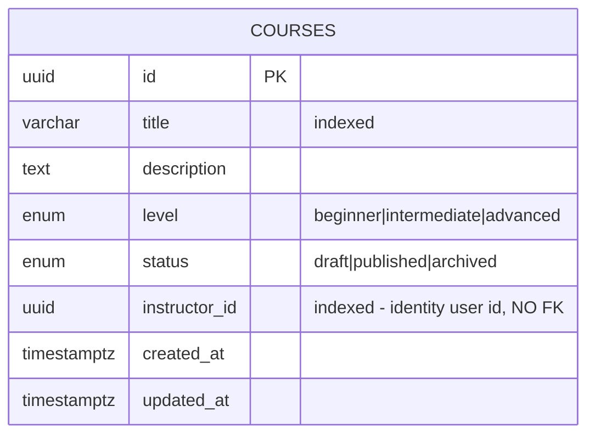

**Planned additions (🟡):** `modules`, `lessons` (body as `jsonb` with a `lesson_type`
discriminator and a `CHECK` per type), `prerequisites`, `course_versions`, `publish_runs`,
`outbox_messages`, `processed_events`, a `tsvector` column with a GIN index for search, and status
values `publishing` / `failed` / `ready`.

### 20.2 Endpoints (✅)

| Method & path | Auth | Behaviour |
| --- | --- | --- |
| `POST /api/v1/courses` | instructor | Creates a `draft`; `instructor_id = token.sub` |
| `GET /api/v1/courses?q=&level=&status=&limit=&cursor=` | public | Keyset pagination; `q` is `ILIKE %q%` on title |
| `GET /api/v1/courses/{id}` | public | 404 if missing |
| `PATCH /api/v1/courses/{id}` | owner or admin | Partial update of title/description/level; never `status` |
| `DELETE /api/v1/courses/{id}` | owner or admin | Soft archive (`status=archived`) → `204` |

### 20.3 Cursor pagination (keyset, not offset)

- Order by `(created_at DESC, id DESC)`. The cursor is base64url JSON `{"created_at", "id"}`.
- Next page: `WHERE created_at < :c OR (created_at = :c AND id < :id)`. This stays stable when rows are inserted concurrently and costs O(limit) instead of O(offset).
- Fetch `limit + 1` rows to compute `has_more` without a `COUNT(*)`.

### 20.4 Authorization logic

```python
# services/course/src/modules/courses/service.py
_ADMIN_ROLE = "admin"   # JWT claim value; identity's enum is NOT imported (no shared business enum)
def _can_modify(course, *, current_user_id, role) -> bool:
    return role == _ADMIN_ROLE or course.instructor_id == current_user_id
```

## 21. Gateway: LLD

| Component | Detail |
| --- | --- |
| `create_app(settings, transport=None)` | Builds one shared `httpx.AsyncClient` (timeout 10 s), a `JWKSVerifier`, and the route table. `transport` lets tests inject fake upstreams |
| `JWKSVerifier` | In-memory `PyJWKSet`. TTL 300 s. On an unknown `kid`, forces a re-fetch at most once every 30 s, so garbage tokens can't turn the gateway into a load generator against identity. On fetch failure it keeps the last good keys. The algorithm is taken from the **published key**, never from the token header, which prevents `alg` confusion attacks |
| `resolve_upstream` | First prefix that matches a whole path segment |
| `_forwarded_headers` | Drops hop-by-hop headers, the incoming `X-Request-ID` and `X-Forwarded-For`. Re-adds `X-Forwarded-For: <prior>, <peer>`, `X-Forwarded-Proto`, `X-Forwarded-Host`, `X-Request-ID` |
| `forward` | Buffers the request and response bodies. Fine for JSON; uploads go to object storage via presigned URLs, never through the gateway |
| Settings | `SMARTCOURSE_UPSTREAMS__{IDENTITY_URL, COURSE_URL, TIMEOUT_SECONDS, JWKS_CACHE_TTL_SECONDS}` |

## 22. Cross-cutting LLD

| Concern | Design |
| --- | --- |
| Configuration | pydantic-settings, prefix `SMARTCOURSE_`, nested with `__`. Each service reads **only its own** `.env`. Settings load eagerly, so a misconfigured deploy fails before it takes traffic |
| Logging | JSON, one access line per request (method, path, status, duration_ms), `request_id` + `service.name` injected automatically. Never logs passwords, tokens or bodies |
| Health | `/health` runs dependency checks concurrently (2 s timeout each, 5 s cache) and returns 200 or 503. `/version` returns git SHA and build time. Startup **never** crash-loops on a missing dependency; it logs a warning and reports through `/health` |
| Timeouts | asyncpg connect 5 s, Redis socket 2 s, gateway upstream 10 s. An unreachable dependency fails fast ([ADR 0005](../adr/0005-mongo-client-server-selection-timeout.md) lesson) |
| Migrations | Alembic per service, against its own DB only. Naming convention fixed for reviewable diffs |
| Quality gates | `make check` runs ruff + mypy `--strict` + pytest (coverage ≥ 80 % per service). Integration tests run against **real** Postgres/Redis via testcontainers, never mocks |

## 23. Planned LLD for the next services (🟡)

```sql
-- every producing service
CREATE TABLE outbox_messages (
  id            uuid PRIMARY KEY,           -- = event_id
  topic         text NOT NULL,
  aggregate_id  uuid NOT NULL,              -- partition key
  payload       bytea NOT NULL,             -- Avro
  headers       jsonb NOT NULL,             -- traceparent, request_id
  created_at    timestamptz NOT NULL DEFAULT now(),
  published_at  timestamptz
);
CREATE INDEX ix_outbox_unpublished ON outbox_messages (created_at) WHERE published_at IS NULL;

-- every consuming service
CREATE TABLE processed_events (
  event_id       uuid NOT NULL,
  consumer_group text NOT NULL,
  processed_at   timestamptz NOT NULL DEFAULT now(),
  PRIMARY KEY (event_id, consumer_group)
);

-- learning
CREATE UNIQUE INDEX uq_enrollment_active ON enrollments (student_id, course_id) WHERE NOT withdrawn;
```

---

# Part 6: Quality Attributes, Risks, Defence

## 24. Non-functional requirements: how they are met

| NFR | Mechanism | Status |
| --- | --- | --- |
| **Scalability** (tens of thousands of concurrent learners) | Stateless gateway and services, scaled horizontally per service. Async I/O end to end. Keyset pagination. Catalogue cache in Redis; DB per service, split to separate instances under load | ✅ foundation · 🟡 caching |
| **Availability** | Offline JWT verification (identity down ≠ platform down). JWKS cache with stale-key fallback. Local read models remove runtime coupling. Liveness vs readiness probes split | ✅ / 🟡 |
| **Consistency** | DB constraints for invariants, `FOR UPDATE` for seats, outbox for event atomicity, inbox for exactly-once effects | ✅ constraints · 🟡 rest |
| **Recoverability** | Temporal resumes and compensates; Kafka replay rebuilds projections; DLQ with replay endpoints | 🟡 |
| **Idempotency** | `Idempotency-Key` on ★ endpoints, inbox dedupe, natural keys | 🟡 |
| **Backpressure** | Per-route rate limits (Redis sliding window); Kafka absorbs spikes; Celery with bounded retries and jitter | 🟡 (identity throttles ✅) |
| **Observability** | request-id end to end ✅; OTel traces across Kafka headers, Celery and Temporal interceptors; Prometheus `/metrics`; `/admin/outbox/stats`, `/admin/workflows` | 🟡 |
| **Security** | RS256 + JWKS, Argon2id, rotating refresh with reuse detection, lockout/throttle, no user enumeration, admin not self-assignable, private key isolated to identity, errors leak no internals | ✅ |
| **Maintainability** | Identical service skeleton, auto-discovery, strict typing, ADRs for every non-obvious decision | ✅ |

## 25. Known gaps and risks (found in the code review for this document)

These come from reading the code, not from running an exploit, so treat them as verify-first.
Raising them yourself, with a fix ready, is stronger than having a reviewer find them.

| # | Finding | Impact | Suggested fix |
| --- | --- | --- | --- |
| R1 | `GET /courses` and `GET /courses/{id}` are public and return **every** status, including other instructors' **drafts** and archived courses ([`service.py:51`](../../services/course/src/modules/courses/service.py#L51)) | Unpublished content is exposed | Anonymous callers and students see `published` only; owner/admin see their own drafts |
| R2 | In compose, `FORWARDED_ALLOW_IPS="*"` makes uvicorn trust the **leftmost** `X-Forwarded-For` entry, which the client controls (the gateway appends to it). Service ports 8001/8002 are also published to the host | The per-IP register throttle can be bypassed by sending a fake XFF header | Gateway **overwrites** XFF instead of appending (or sets `X-Real-IP`). Set `FORWARDED_ALLOW_IPS` to the gateway's address. Do not publish service ports outside the network |
| R3 | Refresh rotation reads the token row without a row lock ([`service.py:157`](../../services/identity/src/modules/auth/service.py#L157)) | Two concurrent refreshes with the same token can both succeed and fork the family | `SELECT … FOR UPDATE`, or a conditional `UPDATE … WHERE revoked_at IS NULL RETURNING` |
| R4 | `replaced_by_id` is never set during rotation | Rotation-chain audit trail is incomplete | Set `stored.replaced_by_id = new.id` |
| R5 | Login lockout is keyed by **email only** | An attacker can lock any user out with 5 bad attempts every 5 minutes | Key by `(email, ip)` plus a global per-IP limit; consider progressive delay |
| R6 | Services verify with a **single public-key file**, while the `kid` header and JWKS exist | Key rotation requires redeploying a file to every service; no overlap window | Services load a key **set** (by `kid`) from a file or a cached JWKS; publish old and new keys during rotation |
| R7 | Logout takes effect in non-identity services only at access-token expiry (≤ 15 min) | Documented trade-off ([ADR 0010](../adr/0010-split-into-services.md)) | `session.revoked.v1` event → local denylists, if the product needs it |
| R8 | Gateway fails **open** if JWKS was never fetched | Only the edge check is skipped; services still verify | Acceptable by design; alert on `jwks_fetch_failed` |
| R9 | Catalogue search is `ILIKE '%q%'` (sequential scan); the design calls for `tsvector` + GIN | Slow under a large catalogue | Implement the designed `tsvector` column + GIN index |
| R10 | Outbox/Kafka, Temporal, Celery, tracing/metrics, gateway rate limiting and idempotency keys are not built. The welcome email is a synchronous log stub | Core brief requirements (event-driven, recoverable, traceable) are design-only today | Follow the roadmap (§27) |
| R11 | Brief lists "NoSQL DB" and "Celery with RabbitMQ"; the design removed NoSQL and does not name a Celery broker | Reviewers may say the brief was not followed | Defended in §26 Q1. Confirm the broker choice |
| R12 | Dev JWT keys and `.env` files sit in the working tree (`secrets/`, `services/*/.env`) | Fine locally (gitignored), but must never be shipped in images, slides or repos | Production: secrets manager / K8s secrets. Private key mounted into identity only |

## 26. Defence: likely questions and answers

**Q1. The brief says NoSQL. Why only PostgreSQL?**
Every candidate NoSQL use case has a strong Postgres answer: lesson bodies as `jsonb` with a type
discriminator and `CHECK`s, chunks as a table with a GIN index, projections as rollup tables. A
second engine would add a dual write with no shared transaction on the most basic path, which
causes exactly the inconsistency the brief complains about. It would also double the backup,
migration and operational burden. Document stores win on horizontal write sharding and truly
unpredictable shapes, and neither applies here. Mongo was used in the first scaffold, stored
nothing, and was removed ([ADR 0010](../adr/0010-split-into-services.md)).

**Q2. Why microservices and not a modular monolith?**
The project *started* as a modular monolith ([ADR 0001](../adr/0001-architecture-decisions.md))
and was split ([ADR 0010](../adr/0010-split-into-services.md)) because the workloads scale
differently (login bursts, catalogue reads, enrollment spikes, processing spikes) and fail
differently (a mail outage must not fail enrollment). The split is protected by the four rules
in §6. Without them it would become a distributed monolith.

**Q3. Why a custom gateway instead of Kong or Nginx?**
See §9. In short: one error contract and one request-id/logging stack end to end, a token policy
(signature-only, JWKS cache with refetch throttle, fail-open) that is about 90 lines of Python,
and no extra technology to operate. It sits behind a TLS load balancer in production and can be
swapped without any client change.

**Q4. If the gateway checks the token, why does every service check it again?**
Zero trust inside the cluster. Anything that reaches a pod directly (misconfigured ingress,
port-forward, a compromised neighbour) would otherwise bypass auth. The gateway check is an
optimisation that stops garbage early; the service check is the security boundary.

**Q5. Why doesn't the gateway reject expired tokens?**
Clients send their expired access token when calling `/auth/refresh`. Rejecting expired tokens
at the edge would break refresh. Expiry is enforced by every service.

**Q6. What happens if identity goes down?**
Existing sessions keep working everywhere except identity's own endpoints: services verify
offline with the public key, and the gateway uses its cached JWKS (or fails open). Login,
refresh and registration are unavailable until identity recovers.

**Q7. How does logout work across services?**
Immediately in identity (Redis `jti` denylist). Elsewhere it takes effect at access-token expiry,
at most 15 minutes. That bound is why the access token is short-lived. If the product needs
instant global logout, the answer is a `session.revoked` event feeding local denylists, never a
shared Redis.

**Q8. What if a refresh token is stolen?**
Rotation means the legitimate user and the attacker each hold a token from the same family.
Whichever presents an already-rotated token triggers reuse detection, which revokes the whole
family. Both are logged out and a security event is logged. Known gap: the concurrent-refresh
race (R3).

**Q9. How do services talk to each other?**
Today they don't. Course never calls identity. Target: Kafka events via a transactional outbox
for facts, Temporal activities on per-service task queues for multi-step processes, Celery for
single tasks. No synchronous HTTP between services on any request path; the only exception is
the cached JWKS fetch.

**Q10. How do you guarantee an enrollment and its event are never out of sync?**
The transactional outbox. The enrollment row and the outbox row commit in one transaction, and
only the relay publishes to Kafka. If the relay crashes it republishes, and consumers dedupe on
`processed_events(event_id, consumer_group)`.

**Q11. Why Temporal and Kafka and Celery? Isn't that too much?**
Each solves a different problem: compensation plus durable multi-step state (Temporal),
fan-out plus replay (Kafka), single retryable jobs (Celery). If scope must be cut, Celery goes
first (replace it with a `jobs` table and `SKIP LOCKED`), and Temporal is kept.

**Q12. How do you prevent overbooking a course at launch?**
`SELECT … FOR UPDATE` on the capacity row inside the enrollment transaction, plus a unique
partial index against duplicates. Capacity comes from the event-fed `course_cache`, so it can be
seconds stale. That trade-off goes to the client: accept a small overshoot, add a waitlist, or
reconcile.

**Q13. How do you debug a failed publish?**
`GET /courses/{id}/publish-runs/{run_id}` returns per-step status. Temporal history shows the
failing activity. `workflow.failed.v1` feeds `/analytics/failures`. The request-id/trace-id
links the gateway log line to the worker span in Jaeger (tracing 🟡).

**Q14. Why are dashboards eventually consistent? Isn't that the problem the brief describes?**
The brief's problem is dashboards that *silently disagree* with reality and can't be corrected.
Projections built from a retained Kafka log give a lag that is bounded (seconds), visible
(`meta.as_of`) and correctable (`POST /analytics/projections/{name}/rebuild` replays the log).

## 27. Roadmap (suggested order)

1. **Hardening of what exists:** R1–R6 (draft visibility, XFF, refresh lock, lockout key, key set).
2. **Event spine:** `libs/contracts` (Avro), outbox in identity and course, relay process, Kafka + Schema Registry in compose, first events `user.registered.v1` and `course.*`.
3. **learning service:** `course_cache` consumer, enrollment transaction, `Idempotency-Key` middleware, rate limiting.
4. **Observability:** OTel traces (HTTP → Kafka headers → Temporal interceptors), Prometheus `/metrics`, Grafana dashboards.
5. **content + publishing saga:** Temporal, MinIO, chunks + `tsvector`, versions.
6. **notification** (Celery) and **analytics** (projections, rebuild, DLQ admin).
